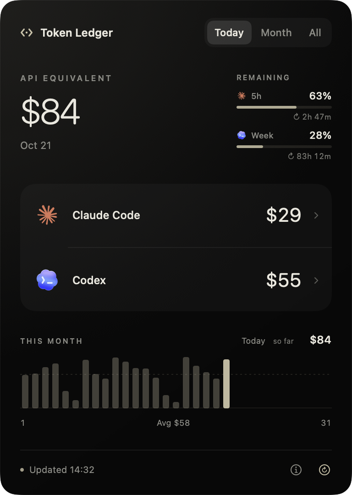
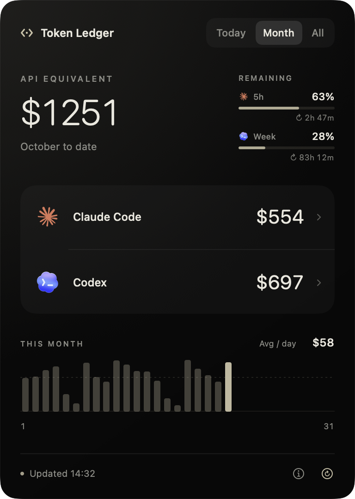
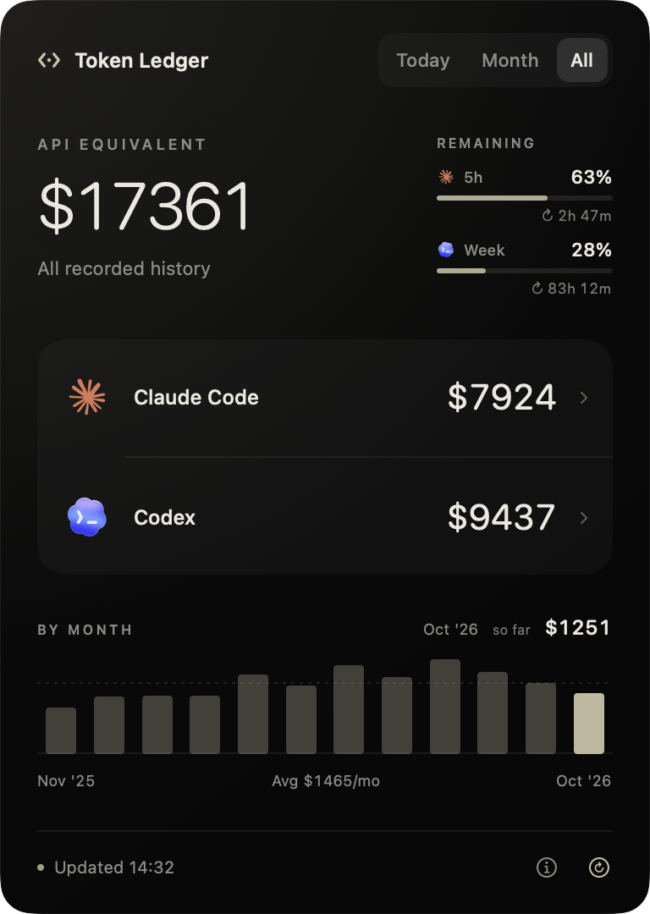

# Token Ledger

A native macOS menu bar app for Claude Code and Codex usage.

<p align="center">
  
  
  
</p>
<p align="center"><sub>Today · Month · All — sample data.</sub></p>

- API-equivalent dollars for today, this month, and recorded history.
- Model breakdowns, recorded Codex Fast subtotals, and interactive charts.
- Claude's 5-hour and Codex's weekly quota, with reset countdowns.
- Local logs, existing sign-ins, no API keys. Updates every minute.

Costs are estimates, **not bills or subscription charges**. Cache pricing is included.
Missing history stays partial. Fast is inferred from recorded mode settings;
UI-only switches and server fallbacks may not be identifiable.

## Build

Requires macOS 14+, Swift 6.2+, Python 3, and [Homebrew](https://brew.sh).
The helper builds from pinned [CodexBar](https://github.com/steipete/CodexBar) source;
the first build takes several minutes.

```sh
brew install zstd
git clone https://github.com/takumi0211/Token-Ledger.git
cd Token-Ledger
./scripts/build.sh
open "build/Token Ledger.app"
```

Move the app to Applications to keep it. Add it to macOS login items to start
at sign-in. Builds are ad-hoc signed for local use, not notarized.
For a separate Swift toolchain, set `SWIFT_TOOLCHAIN=/path/to/toolchain` when building.

## Development

```sh
swift test
python3 scripts/check-engine.py .build/engine/CodexBarCLI
```

Tests use fictional histories and never query account credentials. Cost parsing,
pricing, and request deduplication stay in CodexBar; `patches/codexbar.patch`
adds recorded-speed pricing and exports mode subtotals. Generated dependencies,
binaries, and caches stay in `.build/` and `build/`.

## Data

Reads `~/.codex` and `~/.claude`; `CODEX_HOME` and `CLAUDE_CONFIG_DIR` override them.
Retains observed usage under `~/Library/Application Support/TokenLedger` after
source logs are removed. Snapshots contain amounts and models; compressed Codex
and Claude projections omit message content. Live Codex logs are read through hard
links; originals are never modified. Old aggregate summaries are not added to the totals.

Quota readouts require existing Claude Code / Codex sign-ins and contact the providers. Cost history
is not uploaded; the helper may refresh its public price catalog. Other computers,
cloud-only sessions, and logs deleted before discovery are not included.

## License

MIT. Built on CodexBar by Peter Steinberger and Zstandard. Dependency notices are
in `ThirdParty/`; provider logos remain their respective owners' trademarks.
